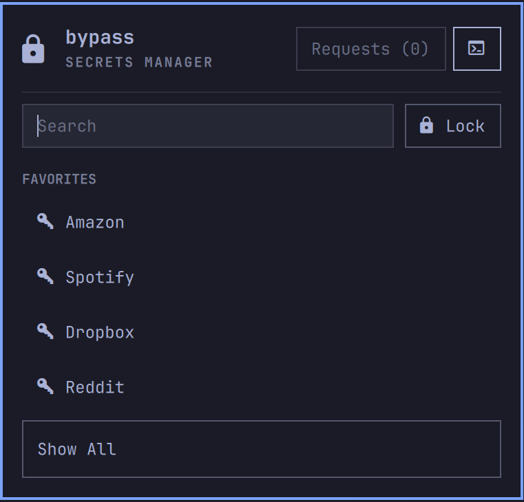

# Bypass for Omarchy

Secrets manager in the Omarchy bar: open KeePass vaults, view your items, and review agent requests.



## Agent interface

Local agents can access secrets from KeePass vaults using `bypass run`. It injects approved secrets 
into commands or scripts without exposing them in the agent's context.

Receive a desktop notification when an agent request is pending. Approve or reject it from the bar widget.

See [CLI.md](https://github.com/yaroshevych/bypass/blob/main/CLI.md) for the full reference and agents interface.

## Human interface

The Omarchy bar widget is optimised for quick access to KeePass secrets.

For the full secrets manager experience, use Bypass: a modern, beautiful
[terminal application](https://github.com/yaroshevych/bypass/) where each detail is crafted:
navigation, controls, keyboard shortcuts, and Omarchy themes.

## Security

For encryption and vault operations, Bypass relies on mature `gokeepasslib` library.

`bypass run` is designed to inject secrets into commands without including them in the agent's context. It does
not prevent executed commands from exposing secrets, for example logging secrets by mistake.

Bypass marks clipboard copies as sensitive so Omarchy's clipboard history skips
them. This requires a Bypass version with sensitive clipboard support and
`wl-copy` with the `--sensitive` option. Clipboard managers that ignore the
sensitive marker may still retain copied data. This does not remove older
clipboard history entries.

After Bypass is updated, close any older Bypass terminal to clear its session
approvals. The widget checks for older or unverifiable running sessions before
unlocking or opening the full app and asks you to close them.

## Requirements

The widget requires Omarchy and Bypass 0.3.5 or later. Opening the full app uses `hyprctl`,
`jq`, and `omarchy-launch-tui`. Clipboard actions use Wayland clipboard tools.
The optional Bypass installer requires `curl`, `sha256sum`, and `tar`;
menu registration uses Python 3. See the [Bypass license](https://github.com/yaroshevych/bypass/blob/main/LICENSE)
and this plugin's [license](LICENSE).

## Install

```sh
omarchy plugin add https://github.com/yaroshevych/omarchy-bypass.git --enable
```

If you installed an earlier version as `bypass.vault`, remove that plugin and
install it again to register the new `bypass.widget` ID:

```sh
omarchy plugin remove bypass.vault
omarchy plugin add https://github.com/yaroshevych/omarchy-bypass.git --enable
```

Open the Bypass icon in the bar. If Bypass is not installed, the widget offers to
install Bypass 0.3.5. The installer downloads the pinned release archive and
verifies it against the checksum in this plugin before installing it. After
installation, it adds Bypass to the Omarchy menu if an entry named `bypass`
does not already exist.

One widget instance is active at a time. If Omarchy creates the bar on multiple
monitors, the widget appears on the first available bar.

## Remove

```sh
omarchy plugin remove bypass.widget
```

Removing the plugin does not uninstall Bypass, delete vaults, or remove the
Bypass entry from `~/.config/omarchy/extensions/omarchy-menu.jsonc`.
To uninstall Bypass installed by the widget, run `rm ~/.local/bin/bypass`.

## Development

Reinstall this checkout into the local shell after changes:

```sh
./reinstall.sh
```

The script validates the plugin, copies and verifies its files, and restarts the
Omarchy shell so it loads the updated QML.

Validate on an Omarchy machine:

```sh
omarchy plugin validate .
qmllint -I "$OMARCHY_PATH/shell" Panel.qml
```

Test with a disposable vault. Check installation and failure recovery, vault
search, copying, locking, approval requests, shell restart, and removal.
